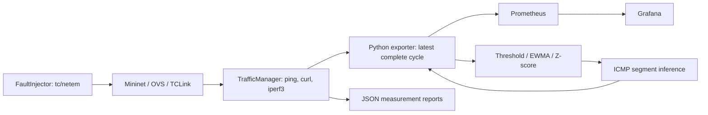

# Innovative Approach to Cloud Application Network Monitoring

**A Multi-Layer, Real-Time Framework for Measuring, Analysing and Visualising the Network Performance of Cloud-Hosted Applications**

## Overview and problem statement

This academic project investigates network and application performance in an
Ubuntu Mininet testbed. End-to-end probes alone show degradation but can obscure
which tier caused it. The project combines active measurements, statistical
anomaly detection and segment inference with an observable monitoring pipeline.
It emulates a cloud application network; it has not been validated against a
production cloud deployment.

## Objectives

Measure latency, loss, availability and TCP performance; expose reproducible
observations; demonstrate controlled impairments and recovery; and report
localization ambiguity honestly.

## Key features

Seven deterministic hosts, five controllerless Open vSwitch bridges and eleven
TCLinks; bounded ping/curl/iperf3 probes; atomic Prometheus snapshots; two
provisioned Grafana dashboards; threshold, EWMA and Z-score detectors; controlled
segment delay/loss/bandwidth changes; and ICMP-based Boolean network tomography.

## Architecture overview and diagram



Fullerenes is optional development tooling and sits outside this data flow.

## Technology stack

Python standard library and `prometheus-client`; Ubuntu Mininet, Open vSwitch,
iproute2/tc, iputils ping, curl and iperf3; Prometheus; and project-local Grafana
OSS 13.2.3. No external OpenFlow controller is required.

## Network topology

All hosts use the same `10.0.0.0/24` L2 network. Switch DPIDs are deterministic
16-character hex strings ending in 1–5; MACs are explicit in
`src/topology/cloud_topology.py`.

| Tier switch | Attached hosts (IPv4) |
| --- | --- |
| s_client | client (10.0.0.10) |
| s_edge | edge_gw (10.0.0.1) |
| s_lb | lb (10.0.0.2) |
| s_app | web_srv (.11), api_srv (.12), auth_srv (.13) |
| s_db | db_srv (10.0.0.20) |

| Segment | Switch link | Bandwidth | Egress delay |
| --- | --- | ---: | ---: |
| seg_client_edge | s_client ↔ s_edge | 100 Mbps | 5 ms |
| seg_edge_lb | s_edge ↔ s_lb | 1000 Mbps | 2 ms |
| seg_lb_app | s_lb ↔ s_app | 1000 Mbps | 1 ms |
| seg_app_db | s_app ↔ s_db | 1000 Mbps | 1 ms |

Seven host attachment links use 1000 Mbps / 0.1 ms. Four inter-tier links make
eleven total. Delay is applied to both egress directions, so its contribution
to round-trip time is approximately twice the configured per-direction delay.
Host tier names describe roles: actual routing, load balancing, authentication,
API and database application services are not implemented. The web service is
a fixed Python HTTP response; iperf3 servers run on web_srv and db_srv.

## Metrics collected

| Observation | JSON unit | Prometheus metric / unit |
| --- | --- | --- |
| ICMP mean/min/max RTT | ms | cloud_ping_latency_seconds / min_seconds / max_seconds |
| RTT standard deviation (mdev) | ms | cloud_ping_variation_seconds |
| ICMP loss | percent | cloud_packet_loss_ratio (0–1) |
| HTTP total and connect time | ms | cloud_http_response_seconds / cloud_http_connect_seconds |
| HTTP availability and last status | ratio / code | cloud_http_success_ratio / cloud_http_status_code |
| Receiver TCP throughput | Mbps | cloud_throughput_bits_per_second |
| Optional sender retransmissions | count per test | cloud_tcp_retransmissions (gauge) |
| Optional sender RTT | ms | cloud_tcp_rtt_seconds |
| Probe health and measurement time | boolean / Unix seconds | cloud_probe_success / cloud_probe_timestamp_seconds |

Probe labels identify `source`, `target`, and, where applicable, `probe`.
RTT mdev is a variability proxy, not RFC-defined one-way jitter. Missing latency
or throughput remains null in JSON and absent in exposition. Measured 100% loss
remains visible. HTTP timing aggregates are omitted if any request failed.
`cloud_collection_success` means a collection completed, while
`cloud_measurement_cycle_success` means baseline probes passed. Prometheus `up`
only means the exporter was reachable.

## Monitoring and data flow

A cycle sequentially probes five ICMP paths, HTTP client → web, and TCP client →
web/DB. Scrapes read an atomic snapshot and do not generate additional traffic.
The idle interval follows a complete cycle; active probes add their own runtime.
Original probe timestamps distinguish historical playback from fresh data.

## Anomaly detection

Threshold checks use path-specific RTT limits, loss ratio, HTTP timing/status and
minimum throughput. EWMA tracks a mean and mean absolute deviation, with warm-up
and damped outlier updates. Z-score uses a bounded sliding window with minimum
samples and protection for zero variance. Configuration parameters are validated.
`cloud_anomalies_total` is a current-cycle gauge despite its inherited name;
multiple algorithms can count the same event. Defaults are lab assumptions,
not calibrated accuracy claims.

## Fault injection

`FaultInjector` uses Mininet TCIntf on the four declared switch links. It validates
delay strings, finite loss in [0,100] percent and bandwidth in (0,1000] Mbps,
checks tc command output and HTB/netem presence on both interfaces, and retains
restoration ownership before changing either interface. Partial failures attempt
rollback; failed restoration stays tracked and is reported. Restoration uses the
declared topology baseline, not an arbitrary external qdisc configuration.
`net=None` is simulation only. It does not inject kernel faults.

## Fault localization

ICMP observations cover a path-to-segment matrix. Healthy paths eliminate their
segments; degraded paths yield candidate intersections, or a union if a single
fault cannot explain them. Application errors alone do not identify network
segments. Missing coverage and conflicting evidence are inconclusive. The default
paths cannot distinguish seg_edge_lb from seg_lb_app. Confidence is the heuristic
`1 / candidate count`, not a calibrated probability. Inferences assume the lab
routing matrix and should not be described as definitive real-world diagnosis.

## Repository structure

```text
src/topology/       deterministic topology and safe experiment lifecycle
src/traffic/        active probes, owned services, fault injection
src/monitoring/     exporter and owned Prometheus/Grafana helpers
src/analysis/       anomaly detectors and segment localization
config/            Prometheus and Grafana provisioning/dashboard JSON
scripts/           setup, runners, acceptance checks, optional agent tools
tests/             unittest suite and explicitly synthetic fixture
docs/              historical evidence, experiment and current audit notes
.runtime/          ignored downloaded binaries and optional agent dependencies
results/           generated measurements and service data; selected paths ignored
```

## Prerequisites for Ubuntu

Use Python 3.12 or later; this audit executed Python 3.14.4 on Ubuntu Linux x86_64.
Other Python versions and operating systems have not been verified. Live tests
require root, kernel network namespaces, an active OVS service, tc/netem and no
colliding project bridges. Ordinary tests require no internet after installation.
The full suite includes real localhost services and requires installed Prometheus,
iperf3 and the local Grafana binary.

## Environment setup

From the existing repository root:

```bash
bash scripts/setup_env.sh
source .venv/bin/activate
```

The script uses sudo for apt installation and starting OVS, then creates a
project venv with `--system-site-packages` so apt's Mininet is visible. It stops
on errors and preserves an existing venv. An older isolated venv can fail the
Mininet import check; inspect it before replacing anything. Full apt setup was
reviewed and syntax-checked, not rerun on a fresh Ubuntu installation.

## Dependency installation

For manual setup, install the packages listed in `scripts/setup_env.sh`, then:

```bash
python3 -m venv --system-site-packages .venv
.venv/bin/python -m pip install -r requirements.txt
.venv/bin/python -c 'import mininet, prometheus_client'
```

Do not expect `sudo python3` to use an activated venv. Use the repository's
absolute `.venv/bin/python` path with sudo, or the system Python with apt's
`python3-prometheus-client`. No ML or plotting dependencies are required by the
current code. Optional Fullerenes setup is in [docs/fullerenes.md](docs/fullerenes.md).

## Start the network topology

```bash
sudo .venv/bin/python -m src.topology.cloud_topology
```

This interactive CLI uses the collision-checked lifecycle and tears down its
owned network on exit. Do not start it alongside a runner that builds the same
topology. The exporters do not attach to an already-open interactive topology.

## Start traffic generation and measurements

```bash
sudo .venv/bin/python scripts/run_traffic_test.py
```

This finite run creates its network, starts three owned services, collects and
saves JSON, reports failures with nonzero status, and stops owned resources.

## Start the metrics exporter

Standalone, without sudo or a newly created network:

```bash
python3 src/monitoring/exporter.py --results-dir results
# Module form from the repository root also works:
python3 -m src.monitoring.exporter --results-dir results
```

It listens on loopback port 9200 and reads the newest immutable
`traffic_metrics_*.json` report. No reports means exporter status only, no invented
probe values. `--report PATH` loads one fixed historical report; `--port PORT`
changes the listening port. Malformed imports clear stale measurements and log
errors. Ctrl+C closes the socket. Binding errors report the actual failure.

For continuous **live** collection and the full stack:

```bash
sudo .venv/bin/python scripts/run_monitoring.py --grafana
# Finite demonstration:
sudo .venv/bin/python scripts/run_monitoring.py --cycles 3 --grafana
```

The live runner needs sudo for Mininet and link shaping. It creates its own
network; it reuses an existing Prometheus only after checking its scrape target.
Existing Grafana reuse checks health, but users must verify its datasource and
provisioning. Owned services stop on exit; reused services remain running.
Defaults can be overridden with `--exporter-port`, `--prometheus-port`,
`--grafana-port`, `--interval` and `--cycles` (0 means continuous).

## Start Prometheus

The live runner starts an owned instance if needed. For a separate manual
process, run in a terminal with the exporter already running:

```bash
promtool check config config/prometheus.yml
prometheus --config.file=config/prometheus.yml --web.listen-address=127.0.0.1:9091 --storage.tsdb.path=.runtime/prometheus-data --storage.tsdb.retention.time=24h
```

Do not launch another process when 9091 is occupied. The checked-in configuration
scrapes `127.0.0.1:9200` every two seconds; owned verifier instances use one second.
Update a manually managed scrape target when selecting a different exporter port.

## Start Grafana

After reviewing the pinned official archive download (approximately 461 MB):

```bash
python3 scripts/install_grafana.py
```

The installer verifies SHA256, uses safe staged extraction and refuses to
overwrite an existing installation. This audit reused the installed runtime and
checked the checksum against the [official download page](https://grafana.com/grafana/download/13.2.3?edition=oss&platform=linux).
Use `scripts/run_monitoring.py --grafana` to supply provisioning environment paths
and launch it. The localhost-only instance enables anonymous read-only Viewer
access, disables the login form, and generates an admin password that is not
printed. No verified default admin credentials are supplied by this project.

## Dashboard URLs

- Exporter: <http://127.0.0.1:9200/metrics>
- Prometheus: <http://127.0.0.1:9091> (inspect Targets and `up`)
- Overview: <http://127.0.0.1:3000/d/cloud-network-overview>
- Anomalies and inference: <http://127.0.0.1:3000/d/cloud-anomaly-detection>

Overview panels show reachability, availability, probe age, timings, loss,
throughput, variability and collection status. The anomaly dashboard shows
algorithm findings, explicit inference status, candidates and confidence.
Both refresh every five seconds; exporter UP does not imply fresh probes.

## Run unit tests

```bash
python3 -m unittest discover -v -s tests
```

The suite mixes unit/mocked tests with real loopback process/service integration.
As non-root, two live Mininet tests skip explicitly. All other tests still run;
no assertion is weakened to hide failures. For only pure detector/inference units:

```bash
PYTHONPATH=tests python3 -m unittest -v test_anomaly test_localiser test_fault_injection
```

## Run simulation or recorded-data tests

```bash
python3 scripts/verify_phase6.py --simulated
python3 scripts/verify_exporter.py --port 9200
```

Simulation uses `tests/fixtures/simulated_baseline.json`, labelled synthetic,
through a real exporter and isolated Prometheus. Optional `--baseline-report PATH`
uses a supplied template but simulated impairments remain simulation.
For previously saved actual data, replace paths with your own evidence:

```bash
python3 scripts/verify_phase4.py --recorded-report /absolute/path/to/traffic_metrics_REPORT.json
python3 scripts/verify_phase5.py --recorded-directory /absolute/path/to/phase4_verification_DIRECTORY
```

Phase 5 playback requires a successful live Phase 4 record with its referenced
files available. Existing older metadata uses absolute paths; moved evidence
requires explicit path review. Recorded probes retain their original timestamps.
These commands do not establish live Mininet functionality.

## Run live Mininet tests

After inspecting existing bridges and stopping the owning project session:

```bash
sudo ovs-vsctl list-br
sudo .venv/bin/python -m unittest discover -v -s tests
sudo .venv/bin/python scripts/verify_phase3.py
sudo .venv/bin/python scripts/verify_phase4.py
sudo .venv/bin/python scripts/verify_phase5.py
```

Root is required to create namespaces, virtual links and OVS bridges. Do not use
blanket `mn -c` or kill processes by port/name. A collision refusal is a safety
check; inspect ownership rather than deleting existing resources.

## Execute fault-injection experiments

```bash
sudo .venv/bin/python scripts/verify_phase6.py
```

This creates its own temporary network and exercises baseline, 50 ms per-direction
client-edge delay, deterministic 100% app-DB loss, 40 ms per-direction core delay,
restoration and recovery. The deterministic outage replaces a statistically
unreliable three-packet 25% live-loss check; simulation retains 25% synthetic loss.
Delay overrides the baseline, rather than adding exactly that amount to RTT.
Live fault application and restoration still require new privileged acceptance.

## Reproduce and export experiment results

Each run writes a new `results/phase*_verification_<time>/` directory or unique
`traffic_metrics_<time>_<id>.json` records. Inspect `verification.json`, mode,
settings, stage results and cleanup before using evidence. JSON is the supported
export format; copying a reviewed report preserves all units and original times.
See [docs/experiments.md](docs/experiments.md) for conditions and provenance.
No performance graphs or numerical improvement claims were created by this audit.
Curate small sanitized reports under docs; never publish raw service databases.

## Troubleshooting

- **9200 unavailable:** inspect `ss -ltnp`, runner exit status and
  `results/monitoring_*/session.json`. Direct-file import startup is fixed.
  `python3 scripts/verify_exporter.py --port 9200 --prometheus-port 9091` verifies
  a temporary exporter and an already configured scrape, then closes that exporter.
- **Address already in use:** preserve the listener; inspect its owner/configuration.
  Existing Prometheus/Grafana without an exporter does not prove collection runs.
- **Mininet import fails:** use the apt-compatible system-site-packages venv.
- **Existing project resources:** stop the owning experiment normally; review stale
  resources manually. This audit found project bridges and did not remove them.
- **Sandbox socket errors:** localhost tests need socket-capable execution; root
  is unnecessary for these checks. Live networking separately needs sudo.
- **Empty panels:** check `up`, collection status, probe age and missing-data
  semantics. Range panels need sufficient scrape history.
- **sudo authentication required:** authenticate in your terminal; never send
  passwords to the agent. No live fault injection ran in this audit.

## Security considerations

Bind local services to loopback. Keep secrets, environment files, private keys,
Grafana databases, raw logs and agent indexes out of Git. Read-only anonymous
Grafana is a local lab setting, not a public deployment configuration. Review npm
and download sources; never run a remote shell installer. Active throughput tests
load the emulated network. Mininet naming/collision guards do not make arbitrary
root scripts safe.

## Current verification status

See [docs/audit-2026-10-11.md](docs/audit-2026-10-11.md) for exact final commands and
outcomes. The final suite ran 86 tests: 84 passed and two root-only tests skipped.
The initial suite was 73 tests (71 passed, two root-only skips) outside
the socket-restricted sandbox. Standalone exporter binding, HTTP exposition and
existing Prometheus scraping were directly verified, then the owned exporter was
stopped. Recorded Phase 4 ingestion and Phase 5 panel queries passed. Portable
Phase 6 simulation passed. New live Mininet/fault tests are blocked by interactive
sudo and existing project resources. Historical evidence is separately labelled.

## Known limitations

The network is an L2 academic emulator, not a deployed cloud service. Sequential
active samples and tiny ping batches limit statistical conclusions. Core segments
can be indistinguishable; multiple faults/noise can violate the model. Confidence
is heuristic. Genuine one-way jitter and passive flow collection are absent.
Grafana provisioning and query checks do not prove browser visual layout.
Fresh-machine Ubuntu setup and modified live cleanup require further verification.

## Future work

Calibrate thresholds with repeated live baselines; evaluate multi-fault and noisy
observations; add recorded-data path portability and research plotting; implement
optional disambiguation probes. Passive NetFlow/IPFIX, SNMP/eBPF, Isolation Forest,
Kafka or Kubernetes monitoring are not implemented.

## License

No project license is present. The owner must select an appropriate license before
claiming the repository is open source. Third-party dependencies retain their
own licenses; Fullerenes is MIT and Grafana OSS is AGPLv3. This audit did not
choose a license on the owner's behalf.
