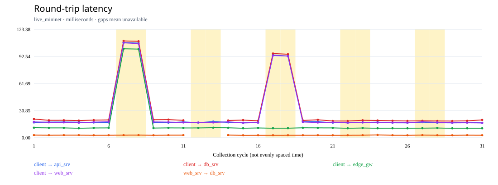
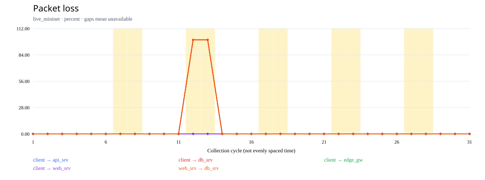
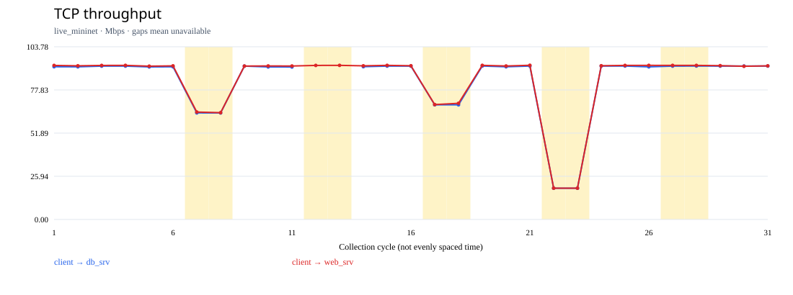
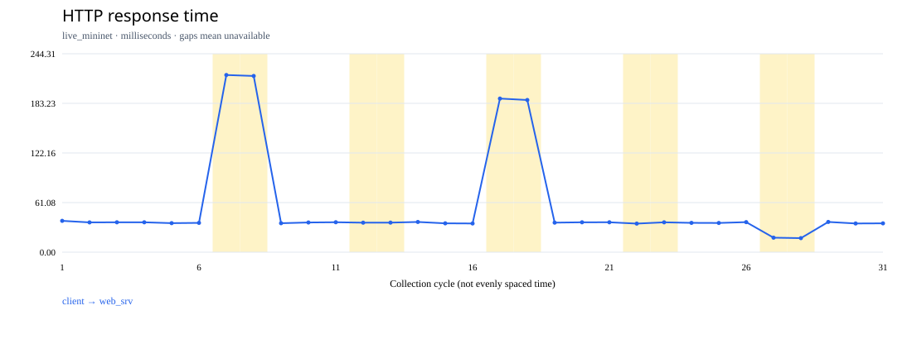

# Final live experiment results — 22 October 2026

**Core live acceptance: PASSED.** Tested source revision: `4540a7f`.

The user ran the privileged acceptance command. The agent independently inspected
the saved logs, raw measurements, analysis, qdisc/class snapshots and cleanup flags.
All 31 cycles reproduced their saved anomaly/localization findings when reanalyzed,
and detector evaluation recomputed identically. No measurements were invented.

## Acceptance

| Check | Result |
| --- | --- |
| Unit, structural, process, monitoring and live Mininet tests | 106 passed, zero skipped |
| Prometheus config, setup shell syntax, whitespace | Passed |
| Phase 3: live traffic and repeatability | Passed |
| Phase 4: live ingestion, application failure and recovery | Passed |
| Phase 5: live Grafana provisioning/panel queries | Passed |
| Phase 6: network faults, inference and recovery | Passed |
| Complete 31-cycle live demonstration | Passed |
| Fault restoration and owned resource cleanup | Passed |

The full sequence took 503.4 seconds. It is a single controlled
experiment on the development computer, not a fresh-machine or production benchmark.

## Actual measured behavior

| Condition | Client → web RTT (ms) | Max ICMP loss across measured paths (%) | Client → web throughput (Mbps) | Inferred segment(s) |
| --- | ---: | ---: | ---: | --- |
| Normal (six-cycle median) | 17.563 | 0 | 92.455 | Healthy |
| edge_delay (first fault cycle) | 108.038 | 0 | 64.55 | seg_client_edge |
| database_loss (first fault cycle) | 17.231 | 100 | 92.57 | seg_app_db |
| core_ambiguity (first fault cycle) | 93.601 | 0 | 69.04 | seg_edge_lb, seg_lb_app |
| edge_bandwidth (first fault cycle) | 16.855 | 0 | 18.80 | No segment candidate |
| web_unavailable (first fault cycle) | 17.963 | 0 | 92.60 | No segment candidate |

The database-loss condition affects DB paths while the primary client → web path
continues to work. The loss column therefore uses the maximum across all five
ICMP paths; it is not incorrectly reported as primary-path loss.

Both controlled fault cycles were detected in each scenario. Edge delay localized
to `seg_client_edge`, DB loss to `seg_app_db`, and core delay retained the honest
two-candidate set `seg_edge_lb` / `seg_lb_app`. Bandwidth restriction was detected
from throughput but could not be localized from unchanged ICMP observations.
Stopping HTTP produced failed requests and absent response-time metrics without
falsely attributing the application failure to a network segment.

All five scenarios passed measured recovery. The last recovery returned primary
RTT to 16.785 ms, HTTP response to
35.51 ms and throughput to 92.31 Mbps.

## Detector evaluation for this run

| Method | TP | FP | TN | FN | Precision | Recall |
| --- | ---: | ---: | ---: | ---: | ---: | ---: |
| threshold | 10 | 0 | 16 | 0 | 1.00 | 1.00 |
| ewma | 8 | 0 | 16 | 2 | 1.00 | 0.80 |
| zscore | 5 | 0 | 16 | 5 | 1.00 | 0.50 |

Five warm-up cycles are excluded. The evaluated set contains ten fault cycles
and sixteen normal/recovery cycles. Statistical methods do not turn missing
application response times into numerical outliers; those misses remain visible.
These rates do not establish general real-world detector accuracy.

## Genuine live figures

The figures below come directly from the final live experiment, with no invented
samples. Yellow bands mark controlled-condition cycles, not independent detector
outputs. Gaps mean unavailable measurements. The x-axis is collection index.

## Cleanup and remaining limits

Each link fault has captured before/applied/restored parameters for both egress
interfaces. Restored delay, loss, rate and queue size match the pre-fault values.
The experiment reports successful network and service cleanup, with no active
faults remaining. The known HTB quantum advisory still appears in Mininet logs;
it is accepted only after checking the requested kernel configuration.

The core lab implementation and live acceptance are complete. Browser visual
layout review, fresh-computer installation and production-cloud validation are
not claimed. Candidate confidence remains heuristic and core ambiguity remains.

## Evidence locations

- Reviewed portable summary: [final-live-acceptance-2026-10-22.json](evidence/final-live-acceptance-2026-10-22.json).
- Full local acceptance: `results/acceptance_1792648834955210084/`.
- Full local experiment and HTML report: `results/end_to_end_1792649053214953738/`.
- Methodology: [methodology.md](methodology.md).
- Demonstration steps: [demo-guide.md](demo-guide.md).

Raw service databases/logs and the downloaded runtime remain local and ignored.
